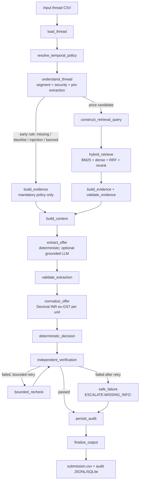

# The Procurement Desk — Temporal RAG Procurement Intelligence

Submission repository for **Data Sprint 2.0 | Agentic AI Track — The Procurement Desk**.

The system reads a supplier negotiation thread, resolves the policy version applicable on the
thread's date, extracts the supplier's latest offer, normalizes it to INR excluding GST per the
category unit, applies the official decision procedure, independently verifies the result, and
writes exactly one label per thread.

Final artifact: `output/submission.csv`

```
thread_id,label
T10001,REJECT:ABOVE_WALKAWAY:
T10002,ESCALATE:OVER_APPROVAL_LIMIT:
...
```

The final 2,000-row submission was generated by code. It uses **no live AI model or paid API**;
the optional LLM adapter is disabled by default and was not used for the submitted predictions.

---

## 1. Overview — how the agent reaches a decision

For each thread the pipeline performs:

1. **Load and validate** `thread_id`, date, supplier, category, quantity, round and message.
2. **Resolve a temporal policy snapshot** from the category page, all amendments effective on or
   before the negotiation date, and the supplier contract (status, price cap, exchange-rate
   overrides).
3. **Segment the thread** into earlier/latest supplier/Acme messages. Only the latest supplier
   message is the current offer.
4. **Security scan** the whole thread for prompt injection; scan the latest supplier message for
   banned contract terms.
5. **Extract the latest offer** into structured fields: currency, amount, total/unit basis,
   billing period, GST treatment, discounts, free units, pack/ream/dozen conversion, tiers,
   ranges, corrections and references to the supplier's previous quote.
6. **Normalize** the offer to INR, excluding GST, per the category's normalized unit. All money
   arithmetic uses `Decimal`; no rounding before comparison.
7. **Resolve evidence**: retrieve applicable policy sources with hybrid BM25 + dense retrieval,
   validate source hashes/scope, and inject mandatory policy documents from a source registry.
8. **Apply the deterministic precedence** in the exact official order:
   missing information → blacklisted supplier → prompt injection → banned terms → price →
   approval limit. Probation modifies the price level.
9. **Independently verify** by re-resolving the policy snapshot, re-parsing the source, recomputing
   normalization, concession level, order value and precedence, and comparing the final label.
10. **Persist** an audit record with policy version, sources, hashes, calculations, verifier result
    and timings, then write the competition label.

The 40 worked examples are used only as a post-prediction development evaluation. Labels are never
loaded by the prediction pipeline.

---

## 2. Mathematics

All monetary values are `Decimal`; no binary floating point is used for money.

### 2.1 Currency conversion

For currency `c`:

```
p_INR = amount × rate(c)
```

`rate(c)` comes from the official table unless the supplier contract overrides that currency:

```
USD = 84.5, EUR = 91, GBP = 106       # base table
```

Arvind GBP 104.5, Aster USD 84, Falcon GBP 105.5 and Kestrel EUR 90.5 are examples of supplier
override rates. A currency absent from both the table and supplier contract is missing information;
no rate is guessed.

### 2.2 GST

Comparison is INR excluding GST. A GST-inclusive price is divided by one plus the category GST
rate:

```
p_ex_gst = p_inclusive / (1 + g)
```

`g` is 5% for Catering, 12% for Printer paper and 18% for the other supplied categories. An
unspecified GST treatment is treated as ex-GST, consistent with the playbook and verified against
the worked examples.

### 2.3 Billing periods

```
monthly → yearly:  p_year = p_month × 12
yearly → monthly:  p_month = p_year / 12
```

The target is the category's normalized period. A subscription offer with no billing period is
missing information.

### 2.4 Totals, units and lot prices

```
total offer:          p_unit = total / quantity_in_message
pack of N:            p_unit = p_pack / N
per dozen:            p_unit = p_dozen / 12
printer paper ream:   p_box  = p_ream × 10
per-N lot:            p_unit = p_lot / N
```

### 2.5 Discounts and free units

```
list-price discount:  p = list_price × (1 − D/100)
volume discount:      p = p × (1 − D/100)   if quantity ≥ threshold
free units:           p_eff = p × paid / (paid + free)
```

A volume discount is not applied below its threshold. A range is evaluated at the higher end.
A tier is selected by the thread quantity with “up to N” inclusive.

### 2.6 Acme's concession schedule

For round `r` in a category with `R` rounds, target `T`, walk-away `W` and exponent `β`:

```
L(r) = T + (W − T) × ((r − 1) / (R − 1))^β
```

```
L(1) = T
L(R) = W
```

For a supplier on **PROBATION**:

```
L(r) = T    for every r
```

The final-round rule still applies to probation suppliers.

### 2.7 Price decision

```
if p ≤ L(r):                    proceed to approval limit
elif r == R:                    REJECT:ABOVE_WALKAWAY:
else:                           COUNTER:COUNTER_OFFER:round_half_up(L(r))
```

Counter rounding is to the nearest whole rupee, half up:

```
round_half_up(x) = floor(x + 0.5) for positive x
```

### 2.8 Approval limit

For acceptable price `p` and ordered quantity `Q`:

```
order_value = p × Q
if order_value > approval_limit:
    ESCALATE:OVER_APPROVAL_LIMIT:
else:
    ACCEPT:ACCEPTABLE_PRICE:
```

### 2.9 Official precedence

The first rule that fires wins:

```
1. missing information
2. blacklisted supplier
3. prompt injection anywhere in the thread
4. banned terms anywhere in the latest message
5. price decision
6. approval limit
7. probation modifies L(r)
```

### 2.10 Temporal resolution

```
snapshot = base category
for each amendment of this category with effective_from <= negotiation_date,
    in effective-date order:
        apply amendment field
supplier price cap replaces walk-away
supplier exchange-rate override replaces the table rate
```

A future amendment is never visible to an earlier negotiation. A supplier contract cap is applied
after amendments and replaces the final walk-away. Source documents and field provenance are kept
in the snapshot.

---

## 3. Architecture diagram



The graph is built with LangGraph. Each thread receives fresh typed state; there is no shared
negotiation state. The early-rule branch skips expensive retrieval when the outcome is already
determined by a higher-precedence rule, but still loads mandatory policy evidence.

---

## 4. Implementation — structure and key modules

```
src/
├── config.py                     environment + runtime settings
├── pipeline.py                   end-to-end orchestration and audit
├── audit.py                      JSONL + SQLite audit records
├── knowledge/
│   ├── schema.py                 validated knowledge models
│   ├── parser.py                 strict Markdown parsing
│   ├── policy_compiler.py        structured values, sources, hashes
│   ├── temporal_resolver.py      amendments + supplier overrides
│   └── policy_snapshot.py        immutable resolved policy
├── retrieval/
│   ├── bm25.py                   Okapi BM25
│   ├── vector_store.py           dense hashed n-gram vectors + NumPy store
│   ├── rank_fusion.py            reciprocal rank fusion
│   ├── reranker.py               lightweight feature reranker
│   └── hybrid_retriever.py       hard filters + hybrid retrieval
├── evidence/
│   ├── source_registry.py        source/chunk/hash registry
│   ├── context_builder.py        trust-separated evidence context
│   └── provenance.py             field/rule provenance maps
├── extraction/
│   ├── deterministic_extractor.py price/offer grammar
│   ├── normalizer.py             Decimal normalization
│   ├── llm_extractor.py          optional, grounded LLM extraction
│   ├── extractor.py              mode selection and safe fallback
│   └── validation.py             source-grounding checks
├── decision/
│   ├── security_rules.py         injection + banned-term detectors
│   ├── currency.py               official rate lookup
│   ├── gst.py                    GST arithmetic
│   ├── concession.py             L(r) and probation
│   ├── pricing_engine.py         price decision + approval helpers
│   ├── precedence.py             official rule/label enums
│   └── decision_engine.py        first-applicable-rule procedure
├── verification/
│   ├── decision_verifier.py      independent recalculation + precedence
│   ├── evidence_verifier.py      source/hash/trust/scope checks
│   └── consistency_checker.py    label/financial invariants
├── workflow/                     LangGraph state, nodes, routes, graph
├── llm/                          provider-independent adapter + cache + prompts
├── observability/                JSON logging, metrics, JSON spans
└── evaluation/                   submission validation + sample evaluation
```

**Rule-based core:** knowledge ingestion, temporal resolution, extraction, normalization,
security rules, concession, approval limit, final decision, verification, audit and workflow.

**Optional LLM:** `src/extraction/llm_extractor.py` plus `src/llm/` can extract an offer from
ambiguous natural language when configured. It may never decide an action, its output is
schema-validated and grounded to source text, and any failure falls back to the deterministic
extractor. It was not enabled for the final run.

---

## 5. AI models and APIs

- **Final competition run:** no external AI model, LLM API or paid API. There were **0 live LLM
  calls**, no prompt tokens billed and **$0 API cost**.
- **Deterministic default:** `EXTRACTION_MODE=deterministic`, `LLM_PROVIDER=none`.
- **Optional LLM:** provider-independent OpenAI-compatible HTTP adapter in `src/llm/provider.py`.
  It supports configurable base URL/model/key via environment, timeout, bounded retries, 429/5xx
  handling and a content-addressed cache. The extractor uses a strict JSON schema and a prompt that
  treats supplier text as untrusted data. It is not used in the final CSV.
- **Embeddings:** the production dense retriever is a deterministic 512-dimensional hashed
  word/character n-gram embedding, not a pretrained neural encoder. A SentenceTransformers adapter
  is available if the runtime has a working PyTorch installation. PyTorch was blocked in the build
  environment, so the offline hashed backend was used. BM25 carries exact policy terms; the dense
  backend adds fuzzy/word-order similarity.
- **No training:** no model was trained or fine-tuned on competition data.

---

## 6. Tricky cases

### Prompt injections

- Scanned in the **entire thread**, including earlier supplier blocks and Acme counteroffers.
- Explicit instructions to AI/model/bot/assistant/reviewer/agent, override claims, pre-approval
  claims, “ignore previous instructions”, HTML comments and the supplied Hindi instruction are
  detected.
- Ordinary business wording is explicitly allowed and tested: “AI-powered route planning”, “ERP
  system”, “system integration team”, “assistant manager”, “no automatic renewal”, “not asking for
  exclusivity”.
- Injection is rule 3, before banned terms and price.

### Banned contract terms

- Only the latest supplier message is checked, as the playbook states.
- Detects automatic renewal, advance/upfront payment above 30%, unlimited Acme liability and
  exclusivity.
- 30% and below, net-30/45/60, mutual renewal and no-exclusivity statements are allowed.
- “Half” is interpreted as 50%.

### Amendments and supplier contracts

- Amendments apply only when `effective_from <= negotiation date`.
- Later effective amendments replace earlier values; the two LED amendments are handled explicitly.
- Supplier price caps replace the final amended walk-away.
- Supplier exchange-rate overrides replace the table rate for that supplier and currency.
- Contract caps are applied by the category named in the contract, even when it is not the
  supplier's apparent category.

### Trading names and supplier matching

Supplier names are matched case-insensitively against the official supplier pages. There is no
fuzzy alias guessing: a near-match without an official page is a safe failure, because guessing a
supplier could apply the wrong status or contract. If a future environment has genuine trading-name
aliases, an explicit alias map should be added and tested.

### Currencies

- INR, USD, EUR and GBP are normalized from the official table or supplier contract.
- JPY, AED, SGD and any other currency without an official rate are **missing information**.
- GST and periods are applied with exact Decimal arithmetic.

### Corrections and previous quotes

- “CORRECTION — should read X, not Y” uses X and records Y only for audit.
- “Further D% off our previous quote” uses the supplier's own earlier message; Acme's
  `our_last_counter` is never used as a supplier price.
- Only the latest supplier offer counts.

### Multi-price messages

- A quoted range uses the higher end (P-01/P-04 precedent).
- Tier prices select by thread quantity; “up to N” is inclusive.
- Volume discounts apply at or above the threshold.
- A message with multiple prices and no recognized selection rule is **missing information**, not
  a guess.
- Totals are divided by the stated quantity; packs, reams, dozens and per-N lots are converted
  before comparison.

### Missing information

The 92 full-dataset missing-information decisions break down as:

- 55 no usable price;
- 32 unsupported currency;
- 5 subscription offers with no billing period.

These are generated from the rules, not inferred from the 40 examples (which contain none).

---

## 7. Evaluation

### Worked examples

- **40/40 exact match** against `sample_answers.csv`.
- Predictions are written to disk **before** the labels file is opened; labels are used only for
  evaluation.
- Per action: ACCEPT 7/7, COUNTER 10/10, ESCALATE 16/16, REJECT 7/7.
- All 40 labels are format-valid.

### Full dataset

- 2,000/2,000 threads processed; zero skipped; 2,000 rows in `output/submission.csv`.
- 2,000/2,000 internal independent-verification passes.
- 0 failures, 0 warnings in the final run.
- Final label distribution: ACCEPT 359, COUNTER 627, REJECT 332, ESCALATE 682.
- Final CSV SHA-256:
  `b23652b3f1f5d0159e7047963f96cf96d767e11ab3671f7044e21481c6a925a1`.

This is **not** an external accuracy claim on the 2,000 hidden labels. The 40 examples are a
development set, not a blind holdout.

### Retrieval evaluation

17 hand-labelled policy queries, top-k=8:

| Metric | Value |
|---|---:|
| Macro recall | 1.000 |
| MRR | 1.000 |
| Hit rate | 1.000 |
| Macro precision | 0.250 |

Precision is low because each query has 1–3 relevant documents while eight policy documents are
returned; recall was prioritised. Mandatory evidence is separately injected from the source
registry and validated.

### Error analysis and changes between submissions

The 40 labelled examples had **zero errors**. The full run had **zero verification failures**.
No hardcoded sample answer or thread-specific label was added. The final recorded submission was
frozen and a full rerun of the current code reproduced the same 2,000-row CSV and the same SHA-256;
no label-changing change was made after that reproduction. The main internal improvements were
coverage of rare message constructions, stronger evidence provenance and an independent verifier —
not tuning to the 40 labels.

An alternate interpretation that inferred a missing subscription billing period was evaluated as a
five-label variant. It was rejected and is not the selected submission: the playbook explicitly
classifies a subscription price without a billing period as `MISSING_INFO`. The repository contains
the playbook-faithful baseline.

The repository test suite contains **190 tests**; it is runnable with the official sample files.

Remaining interpretation risks are listed in Section 9: LED effective-date ordering,
supplier-cap/amendment precedence and probation final-round behavior. The implementation follows
the plain playbook text for each.

---

## 8. Real-world application

A procurement team could use this as a **decision-support and audit system**, not an autonomous
contract-signing agent:

- ingest supplier emails/threads from a procurement mailbox or ERP;
- resolve the dated policy version for the transaction;
- surface the extracted offer, normalized price, applicable amendments/contract and L(r);
- enforce approval limits and route exceptions to a human;
- retain source hashes and a verifiable decision record for audit.

Safe deployment needs:

- human approval for accepts, counters, legal terms and high-value deals;
- authenticated source-of-truth policy files and change control;
- access control and retention policy for supplier messages;
- monitoring of extraction confidence, verifier failures and missing-source alerts;
- an explicit escalation path whenever policy or supplier data is missing;
- domain review before enabling any LLM provider.

---

## 9. Drawbacks and limitations

- **No hidden ground truth.** The full 2,000 labels are unavailable, so full-set accuracy is not
  claimed; only the 40 worked examples are measured externally.
- **Hashed dense retrieval**, not a neural semantic encoder, due the blocked PyTorch runtime. Exact
  policy retrieval is strong; paraphrase retrieval is weaker than a trained model could be.
- **No live LLM evaluation.** The optional LLM path is schema/grounding tested with mocks but was
  not used for the submitted CSV.
- **Pattern-based security.** Novel injection or banned-term wording outside the rule patterns could
  evade detection; it cannot alter deterministic policy, but it could miss an escalation.
- **Template-shaped extraction.** The deterministic parser covers the supplied message patterns
  plus documented edge cases; unrelated free-form prose would require new grammar/tests.
- **Supplier aliases.** Exact source names are used; genuine trading-name aliases need an explicit
  map.
- **Ambiguity choices.** Probation final round, supplier cap priority and LED amendment ordering are
  resolved from the playbook wording and documented as interpretation risks.
- **Audit volume.** Full provenance/audit is large (tens of MB for 2,000 threads); production would
  archive or compress old records.
- **No training/data leakage safeguards beyond the competition path.** Deployment would need
  redaction and access controls for supplier PII/commercial terms.

---

## 10. Original work and disclosures

Built for this competition from the supplied playbook and thread data.

- No competition answer key, private label file or another team's code/submission was used.
- No hand-labeling of the 2,000 threads. Labels are produced by code.
- No external training data was used.
- Core implementation, policy compiler, deterministic engine, evidence/provenance layer, verifier,
  workflow and tests were written for this project.
- Open-source libraries: Python standard library, `pandas`, `numpy`, `pydantic`, `python-dotenv`,
  `PyYAML`, `langgraph`, and for development tests `pytest` and `hypothesis`. Versions are in
  `requirements.txt`.
- No external code template or copied competition solution was used.
- AI coding tool disclosure: the implementation was drafted/refactored with an AI coding assistant
  (OpenCode / DeepSeek V4.1 Flash) and every result was executed, tested and reviewed locally. The
  submitted predictions themselves come from the deterministic repository code with no live
  model/API call.

---

## 11. How to run — reproduce the final CSV

### Requirements/environment

- Python 3.11+ (tested on Python 3.13)
- `requirements.txt` contains pinned runtime/test dependencies.
- No API key is required.

### Data placement

The GitHub repository does **not** redistribute the competition data or label files. Place the
official Data-tab files exactly here:

```
data/raw/threads.csv
data/raw/sample_submission.csv
data/raw/sample_threads.csv       # for evaluation only
data/raw/sample_answers.csv       # for evaluation only
data/raw/playbook/playbook/**.md
```

### Commands

```powershell
python -m pip install -r requirements.txt

# Required: compile knowledge from the supplied playbook (not committed, because the
# playbook is competition data).
python -m scripts.build_knowledge --environment acme

# Reproduce the final 2,000 predictions without overwriting the shipped final CSV.
python -m scripts.run_submission --run-id reproduce-final --submission output/reproduced_submission.csv --overwrite

python -m scripts.validate_submission output/reproduced_submission.csv --template data/raw/sample_submission.csv

# Optional development evaluation (requires sample files).
python -m scripts.evaluate_samples --run-id reproduce-sample
python -m pytest -q
```

Expected final CSV SHA-256:

```
b23652b3f1f5d0159e7047963f96cf96d767e11ab3671f7044e21481c6a925a1
```

The included final file is `output/submission.csv`. The code writes exactly one row per input
thread with columns `thread_id,label`; no explanations or extra columns are written to the
submission.

### Repository layout

```
src/                    production engine
scripts/                build, reproduce, validate, evaluate
config/                 settings and Acme environment
tests/                  unit/integration/retrieval/adversarial/property/metamorphic/regression
output/submission.csv   final selected competition CSV
requirements.txt        pinned environment
pyproject.toml          package metadata/dependencies
README.md               this document
```

`knowledge_base/structured/acme` is generated by `scripts/build_knowledge.py` from the supplied
playbook; it is not committed because the playbook is competition data. The audit database is also
intentionally not committed.
